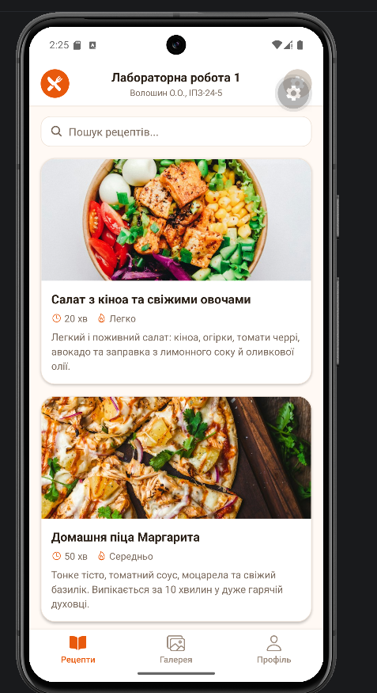
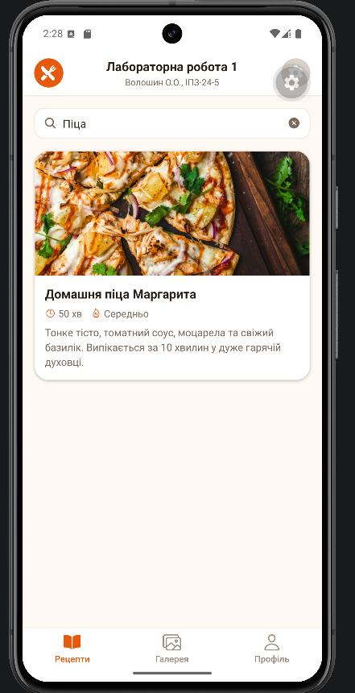
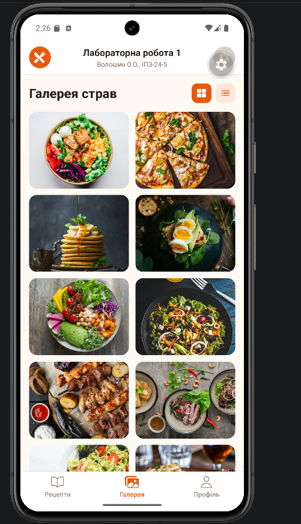
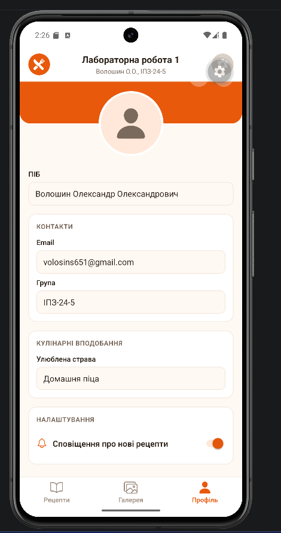

# Лабораторна робота №1

**Тема:** Використання Expo для створення найпростішого додатку React Native. Знайомство з основними компонентами.

**Студент:** Волошин Олександр Олександрович, ІПЗ-24-5

## Опис проєкту

«Книга рецептів» - мобільний застосунок на React Native (Expo SDK 58, Expo Router) з трьома вкладками нижньої навігації:

| Вкладка | Що реалізовано |
|---|---|
| **Рецепти** | Стрічка карток рецептів (`FlatList`): фото, назва, час приготування, складність, опис. Пошук за назвою та описом. |
| **Галерея** | Фотогалерея страв з перемикачем «сітка / список». |
| **Профіль** | Редагування ПІБ, email, групи та улюбленої страви, перемикач сповіщень, кнопки «скасувати» / «зберегти». |

Спільний хедер на всіх екранах містить логотип, назву роботи, ПІБ і групу студента та кнопку налаштувань.

**Використано:** `StyleSheet` API та Flexbox для верстки, Bottom Tabs з Expo Router для навігації, `@expo/vector-icons` (Ionicons) для іконок, `expo-image` для зображень.

### Структура

```
src/
├── app/
│   ├── _layout.tsx          # кореневий Stack
│   └── (tabs)/
│       ├── _layout.tsx      # нижня навігація + хедер
│       ├── index.tsx        # Рецепти
│       ├── gallery.tsx      # Галерея
│       └── profile.tsx      # Профіль
├── components/              # AppHeader, RecipeCard
├── constants/theme.ts       # кольори, радіуси, дані студента
└── data/recipes.ts          # дані рецептів
```

## Інструкція з запуску

### Що потрібно встановити

- [Node.js](https://nodejs.org/) версії 20 або новіше (разом з ним встановлюється `npm`);
- [Git](https://git-scm.com/);
- [Android Studio](https://developer.android.com/studio) зі створеним віртуальним пристроєм: **Device Manager → Create Virtual Device** (наприклад, Pixel 8, Android 15).

### Запуск

1. Клонуйте репозиторій і перейдіть у папку лабораторної:

   ```bash
   git clone https://github.com/Simpson4ik/MobileLabsRN2026.git
   cd MobileLabsRN2026/lab1
   ```

2. Встановіть залежності:

   ```bash
   npm install
   ```

3. Запустіть емулятор в Android Studio (**Device Manager → ▶** біля пристрою) і дочекайтеся, поки він повністю завантажиться.

4. Запустіть застосунок:

   ```bash
   npx expo start --android
   ```

   Під час першого запуску на емулятор автоматично встановиться Expo Go, після чого відкриється застосунок.

> Для відображення фото рецептів потрібне підключення до інтернету.

## Скріншоти

Скріншоти зроблено на емуляторі Pixel 8 (Android 15, API 35).

| Рецепти | Пошук |
|:---:|:---:|
|  |  |
| Стрічка карток рецептів | Фільтрація за запитом «піца» |

| Галерея | Профіль |
|:---:|:---:|
|  |  |
| Галерея страв у режимі сітки | Профіль із контактами та налаштуваннями |

## Висновки

Під час роботи я навчився створювати та налаштовувати проєкт Expo, ознайомився зі структурою застосунку на Expo Router і базовими компонентами React Native (`View`, `Text`, `TextInput`, `FlatList`, `ScrollView`, `Switch`, `Pressable`). Також навчився верстати інтерфейс через `StyleSheet` і Flexbox.

**Основні способи запуску мобільного додатка:**

1. **Expo Go на фізичному пристрої** - найшвидший спосіб, без збирання нативного коду: досить відсканувати QR-код. Застосунок працює на реальному залізі, тож видно справжню продуктивність, поведінку жестів і клавіатури. Обмеження: доступні лише модулі, вбудовані в Expo Go, а телефон має бути в одній мережі з ПК (або потрібен tunnel).
2. **Емулятор Android (AVD)** - не потребує фізичного пристрою, дозволяє тестувати різні розміри екранів і версії Android, зручно робити скріншоти. Мінуси: потребує багато ресурсів ПК і повільніше запускається, частина апаратних функцій (камера, датчики) лише емулюється.
3. **Tunnel (`--tunnel`)** - з'єднання через проміжний сервер, працює, коли телефон і ПК у різних мережах. Повільніше за LAN, але знімає мережеві обмеження.
4. **Онлайн-середовище Expo Snack** - запуск у браузері без встановлення ПЗ. Підходить для швидких прототипів, але має обмеження щодо структури проєкту й залежностей.

У цій роботі застосунок запускався на емуляторі Android: це дало змогу тестувати без фізичного пристрою, швидко перезапускати застосунок і робити скріншоти. Під час налаштування емулятор аварійно завершувався через кирилицю в шляху до SDK, тому SDK і AVD довелося перенести в шляхи латиницею. Для фінальної перевірки продуктивності та жестів варто додатково запускати застосунок на реальному пристрої через Expo Go.
