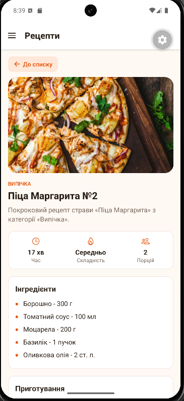

# Лабораторна робота №2

**Тема:** Віртуалізація списків та побудова навігації.

**Студент:** Волошин Олександр Олександрович, ІПЗ-24-5

## Опис проєкту

«Книга рецептів» - мобільний застосунок на React Native (Expo SDK 58, Expo Router) з авторизацією, бічним меню та віртуалізованими списками.

| Екран | Файл | Що реалізовано |
|---|---|---|
| **Вхід** | `app/login.jsx` | Форма з email і паролем, перевірка на порожні поля, після входу перехід у застосунок |
| **Рецепти** | `app/(drawer)/(news)/index.jsx` | `FlatList` на 120 рецептів: Pull-to-Refresh, Infinite Scroll, `getItemLayout`, картка в `React.memo` |
| **Деталі рецепта** | `app/(drawer)/(news)/[id].jsx` | Динамічний маршрут, `id` отримується через `useLocalSearchParams` |
| **Довідковий центр** | `app/(drawer)/faq.jsx` | `SectionList` із запитаннями, згрупованими за темами |

**Архітектура:**

- `context/AuthContext.jsx` - глобальний стан авторизації (`isAuthenticated`, `login()`, `logout()`), провайдер обгортає `app/_layout.jsx`;
- `app/(drawer)/_layout.jsx` - захищена Drawer-навігація: неавторизованого користувача перенаправляє (`<Redirect>`) на `/login`, у меню є кнопка «Вийти»;
- `app/(drawer)/(news)/_layout.jsx` - вкладений Stack із `headerShown: false`, щоб заголовок не дублювався із заголовком Drawer;
- `SafeAreaProvider`, `SafeAreaView` і `useSafeAreaInsets` - захист інтерфейсу від вирізів екрана та системних панелей.

### Структура

```
lab2/
├── app/
│   ├── _layout.jsx              # кореневий Stack + AuthProvider
│   ├── login.jsx                # екран входу
│   └── (drawer)/
│       ├── _layout.jsx          # захищений Drawer
│       ├── faq.jsx              # SectionList
│       └── (news)/
│           ├── _layout.jsx      # вкладений Stack
│           ├── index.jsx        # FlatList рецептів
│           └── [id].jsx         # деталі рецепта
├── components/                  # DrawerContent, RecipeCard
├── constants/theme.js           # кольори, відступи, дані студента
├── context/AuthContext.jsx      # контекст авторизації
└── data/                        # рецепти та FAQ
```

## Інструкція з запуску

### Що потрібно встановити

- [Node.js](https://nodejs.org/) версії 20 або новіше;
- [Git](https://git-scm.com/);
- [Android Studio](https://developer.android.com/studio) зі створеним віртуальним пристроєм: **Device Manager → Create Virtual Device**.

### Запуск

1. Клонуйте репозиторій і перейдіть у папку лабораторної:

   ```bash
   git clone https://github.com/Simpson4ik/MobileLabsRN2026.git
   cd MobileLabsRN2026/lab2
   ```

2. Встановіть залежності:

   ```bash
   npm install
   ```

3. Запустіть емулятор в Android Studio (**Device Manager → ▶**).

4. Запустіть застосунок:

   ```bash
   npx expo start --android
   ```

5. Увійдіть з будь-яким email і паролем.

> Для відображення фото рецептів потрібне підключення до інтернету.

## Скріншоти

| Вхід | Рецепти | Деталі |
|:---:|:---:|:---:|
|  |  |  |

| Бічне меню | Довідковий центр |
|:---:|:---:|
|  |  |

## Висновки

Під час роботи я навчився будувати ієрархічну навігацію в Expo Router (Drawer із вкладеним Stack), захищати маршрути від неавторизованого доступу за допомогою контексту та `<Redirect>`, а також оптимізувати великі списки за допомогою `FlatList` і `SectionList`.

### Відповіді на контрольні запитання

**1. Як працює вкладена навігація в архітектурі Expo Router?**

Expo Router будує навігацію з файлової структури папки `app`. Кожен файл `_layout.jsx` визначає навігатор для своєї папки, а вкладені папки зі своїми `_layout.jsx` створюють вкладені навігатори. Папки в дужках, наприклад `(drawer)` і `(news)`, - це групи: вони не додаються до URL, але дозволяють задати окремий layout. У проєкті кореневий `Stack` містить `login` і групу `(drawer)`, Drawer містить групу `(news)` і екран `faq`, а `(news)` - це Stack зі списком і деталями рецепта.

**2. Яким чином реалізується захист маршрутів від неавторизованого доступу?**

Стан авторизації зберігається в `AuthContext`, яким обгорнуто кореневий layout. У `app/(drawer)/_layout.jsx` перед рендером Drawer перевіряється `isAuthenticated`: якщо користувач не авторизований, повертається `<Redirect href="/login" />`. Оскільки цей layout обгортає всі вкладені екрани, жоден із них не відкриється без входу, навіть через пряме посилання. Після `logout()` стан змінюється, і layout знову перенаправляє на екран входу.

**3. Чим FlatList відрізняється від ScrollView та що таке віртуалізація списків?**

`ScrollView` рендерить усі дочірні елементи одразу, тому на великих списках витрачає багато пам'яті й повільно запускається. `FlatList` використовує віртуалізацію: рендерить лише елементи, які видно на екрані, плюс невеликий запас, а ті, що вийшли за межі, видаляє з пам'яті. Додатково `getItemLayout` дозволяє не вимірювати елементи фіксованої висоти, а `React.memo` запобігає повторному рендеру карток, дані яких не змінилися.

**4. Як отримати параметри динамічного маршруту на цільовому екрані в Expo Router?**

Динамічний сегмент задається назвою файлу у квадратних дужках, наприклад `[id].jsx`. На цьому екрані параметр отримується хуком `useLocalSearchParams()`: `const { id } = useLocalSearchParams();`. Перехід виконується через `router.push({ pathname: "/[id]", params: { id } })` або посиланням на кшталт `/42`.

**5. Яку структуру даних приймає компонент SectionList?**

`SectionList` приймає проп `sections` - масив об'єктів-секцій. Кожна секція має обов'язкове поле `data` з масивом елементів і будь-які додаткові поля, наприклад `title`. Елементи секції рендеряться через `renderItem`, а заголовки секцій - через `renderSectionHeader`.

```js
[
  { title: "Акаунт", data: [{ id: "1", question: "...", answer: "..." }] },
  { title: "Рецепти", data: [/* ... */] },
]
```
