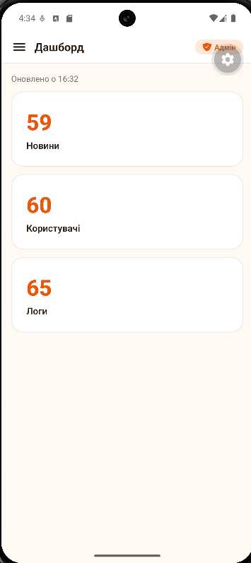
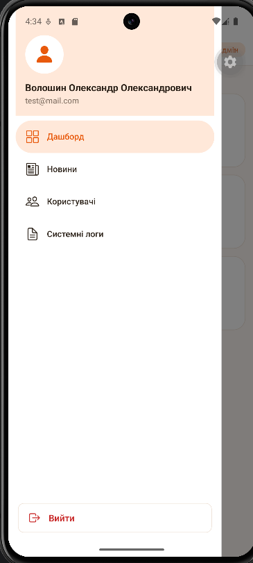
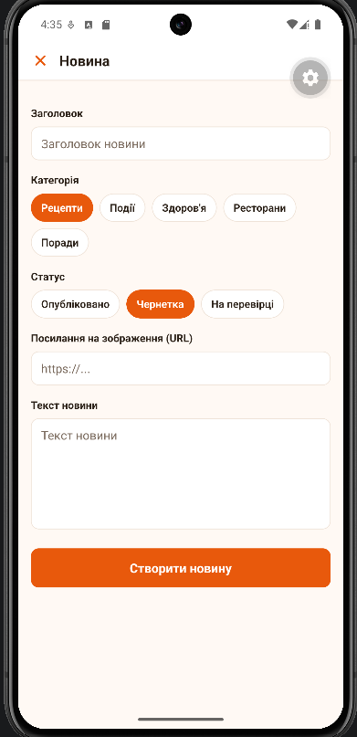
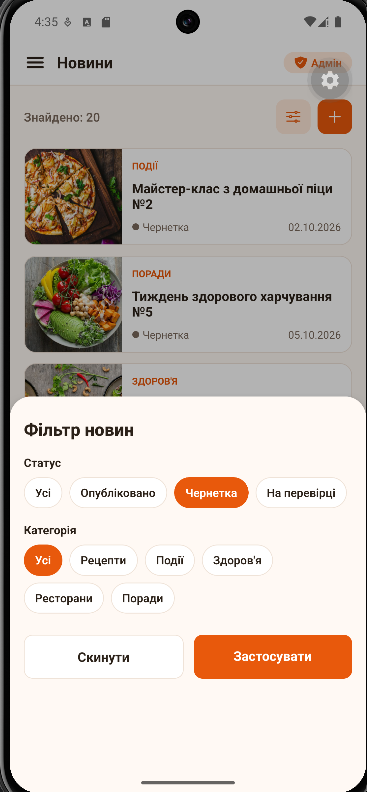
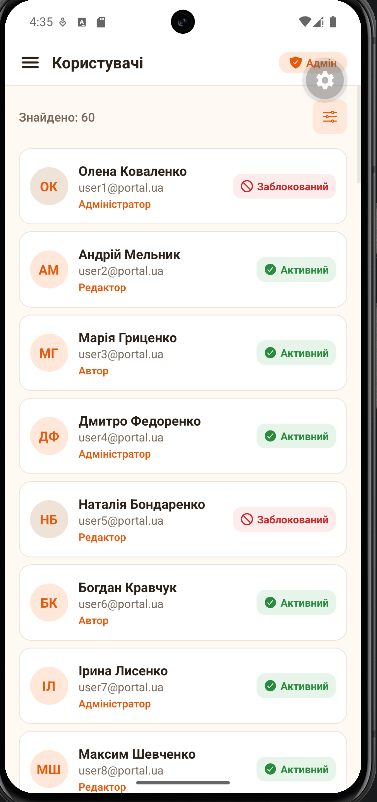
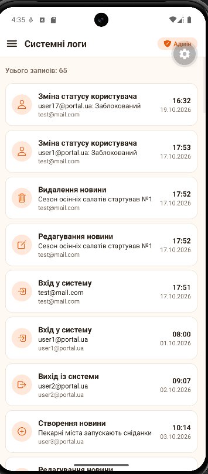

# Лабораторна робота №3

**Тема:** Expo Router: кастомізація навігаційних компонентів, нативні модальні вікна та віртуалізація списків.

**Студент:** Волошин Олександр Олександрович, ІПЗ-24-5

## Опис проєкту

Прототип адмін-панелі кулінарного порталу новин на React Native (Expo SDK 58, Expo Router). Проєкт створено на основі lab2 (вхід, контекст авторизації, тема оформлення), а адмін-розділ написано заново.

| Екран | Файл | Що реалізовано |
|---|---|---|
| **Вхід** | `app/login.jsx` | Форма входу, після входу записується лог «Вхід у систему» |
| **Дашборд** | `app/(admin)/(drawer)/index.jsx` | Кількість новин, користувачів і логів, `useFocusEffect` оновлює дані при кожному відкритті |
| **Новини** | `app/(admin)/(drawer)/news.jsx` | `VirtualizedList` з `getItem`, `getItemCount`, `getItemLayout`, фільтр і кнопка створення |
| **Деталі новини** | `app/(admin)/news/[id].jsx` | Маршрут `/news/[id]`, `id` через `useLocalSearchParams`, редагування й видалення з `Alert.alert()` |
| **Форма новини** | `app/(admin)/news/form.jsx` | `presentation: 'modal'`, створення та редагування новини |
| **Фільтр новин** | `app/(admin)/news/filter.jsx` | `presentation: 'formSheet'` з `sheetAllowedDetents` |
| **Користувачі** | `app/(admin)/(drawer)/users.jsx` | `VirtualizedList`, ролі та статуси, зміна статусу натисканням |
| **Фільтр користувачів** | `app/(admin)/users/filter.jsx` | `formSheet` з фільтром за статусом і роллю |
| **Системні логи** | `app/(admin)/(drawer)/logs.jsx` | `VirtualizedList` журналу подій |

**Архітектура:**

- `context/AuthContext.jsx` - стан авторизації (`login`, `logout`);
- `context/AdminContext.jsx` - масиви новин, користувачів і логів та функції їх зміни. Лог записується лише при 6 подіях: вхід, вихід, створення, редагування, видалення новини, зміна статусу користувача;
- `data/admin.js` - генерація по 60 записів для новин, користувачів і логів;
- `app/(admin)/_layout.jsx` - Stack адмін-панелі: перевіряє авторизацію (`<Redirect>`), реєструє модальні вікна і задає власний хедер через `screenOptions.header`;
- `app/(admin)/(drawer)/_layout.jsx` - Drawer з власним меню `drawerContent={(props) => <AdminDrawerContent {...props} />}`;
- `components/AdminDrawerContent.jsx` - профіль адміністратора (аватар, ім'я, пошта), пункти меню і кнопка «Вийти».

### Структура

```
lab3/
├── app/
│   ├── _layout.jsx                # AuthProvider + AdminProvider
│   ├── login.jsx                  # екран входу
│   └── (admin)/
│       ├── _layout.jsx            # Stack: захист, модалки, screenOptions.header
│       ├── (drawer)/
│       │   ├── _layout.jsx        # Drawer + AdminDrawerContent
│       │   ├── index.jsx          # дашборд
│       │   ├── news.jsx           # список новин
│       │   ├── users.jsx          # користувачі
│       │   └── logs.jsx           # системні логи
│       ├── news/
│       │   ├── [id].jsx           # деталі новини
│       │   ├── form.jsx           # modal
│       │   └── filter.jsx         # formSheet
│       └── users/
│           └── filter.jsx         # formSheet
├── components/                    # AdminDrawerContent, AdminHeader, StackHeader, Chip, NewsCard, UserRow
├── constants/theme.js
├── context/                       # AuthContext, AdminContext
└── data/admin.js                  # генерація даних
```

## Інструкція з запуску

### Що потрібно встановити

- [Node.js](https://nodejs.org/) версії 20 або новіше;
- [Git](https://git-scm.com/);
- [Android Studio](https://developer.android.com/studio) зі створеним віртуальним пристроєм: **Device Manager → Create Virtual Device**.

### Запуск

1. Клонуйте репозиторій і перейдіть у папку лабораторної:

   ```bash
   git clone https://github.com/Simpson4ik/MobileLabsRN2026.git
   cd MobileLabsRN2026/lab3
   ```

2. Встановіть залежності:

   ```bash
   npm install
   ```

3. Запустіть емулятор в Android Studio (**Device Manager → ▶**).

4. Запустіть застосунок:

   ```bash
   npx expo start --android
   ```

5. Увійдіть з будь-яким email і паролем.

> Для відображення фото новин потрібне підключення до інтернету.

## Скріншоти

| Дашборд | Бічне меню | Новини | Форма (modal) |
|:---:|:---:|:---:|:---:|
|  |  |  |  |

| Фільтр (formSheet) | Користувачі | Системні логи |
|:---:|:---:|:---:|
|  |  |  |

## Висновки

Під час роботи я навчився будувати складну ієрархію навігації в Expo Router (Stack поверх Drawer), налаштовувати бічне меню та хедер власними компонентами, використовувати нативні модальні вікна `modal` і `formSheet`, а також оптимізувати списки за допомогою `VirtualizedList`. Спільний стан адмін-панелі зберігається в React Context, тому зміни на одному екрані одразу видно на інших.

### Відповіді на контрольні запитання

**1. Яким чином виконується кастомізація бічного меню та хедера стекової навігації за допомогою drawerContent та screenOptions.header?**

Проп `drawerContent` навігатора `<Drawer>` приймає функцію, яка отримує props навігатора і повертає власний компонент меню. У проєкті це `drawerContent={(props) => <AdminDrawerContent {...props} />}`: компонент малює профіль адміністратора, стандартні пункти через `DrawerItemList` і кнопку «Вийти». Аналогічно `screenOptions.header` у `<Stack>` (і в `<Drawer>`) приймає функцію, що повертає власний хедер замість стандартного. Вона отримує `navigation`, `options` і `back`, тому хедер може показати заголовок з `options.title` і кнопку «Назад» або «Закрити». У проєкті це компоненти `StackHeader` і `AdminHeader`.

**2. У чому відмінність між нативними режимами модальних вікон presentation: 'modal' та presentation: 'formSheet'?**

`modal` відкриває екран поверх поточного як окреме модальне вікно: на Android на весь екран з анімацією знизу, на iOS як картку з можливістю закрити свайпом. Він підходить для повноцінних форм, тому в проєкті так відкривається форма новини. `formSheet` відкриває нижню панель (bottom sheet), яка займає лише частину екрана. Її висоту задає `sheetAllowedDetents`, наприклад `[0.5, 0.85]`, тобто 50% або 85% екрана, і користувач перетягує панель між цими положеннями. Під нею видно попередній екран, тому `formSheet` зручний для коротких дій на кшталт фільтрів.

**3. Для чого використовується хук useFocusEffect і чим він відрізняється від стандартного useEffect?**

`useEffect` виконується при монтуванні компонента та зміні залежностей. Але екрани в навігаторах (Drawer, Stack) не демонтуються при переході на інший екран, тому `useEffect` не спрацює, коли користувач повернеться на екран. `useFocusEffect` виконується щоразу, коли екран отримує фокус, а функція очищення викликається при втраті фокусу. У проєкті дашборд через `useFocusEffect` оновлює дані при кожному відкритті. Функцію в `useFocusEffect` обгортають у `useCallback`, щоб вона не виконувалася на кожному рендері.
