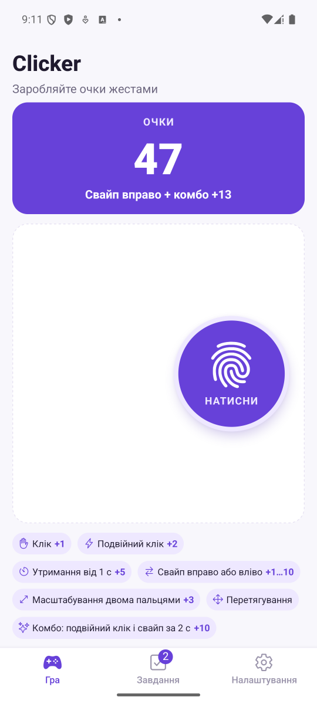
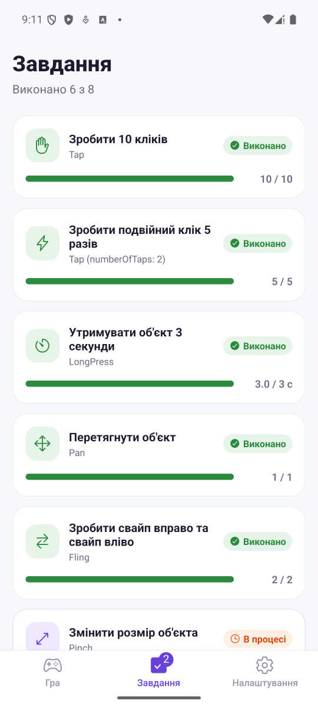
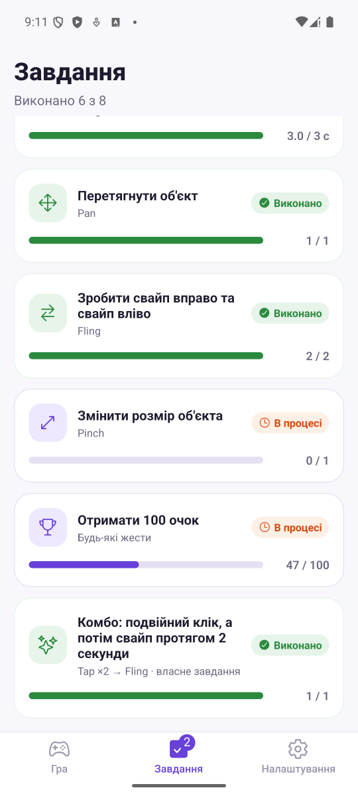
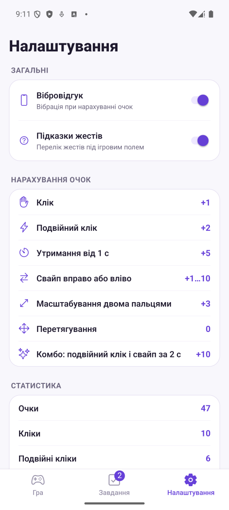
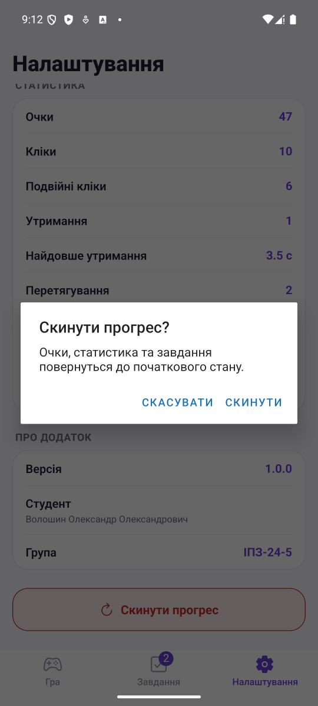

# Лабораторна робота №4

**Тема:** Опрацювання жестів користувача та реалізація інтерактивної взаємодії у React Native.

**Студент:** Волошин Олександр Олександрович, ІПЗ-24-5

## Опис проєкту

Мобільний додаток «Clicker» на React Native (Expo SDK 58, Expo Router). Користувач заробляє очки, взаємодіючи з об'єктом на головному екрані різними жестами. Жести реалізовано бібліотекою `react-native-gesture-handler` 3.3, анімацію об'єкта — `react-native-reanimated`. Проєкт створено командою `npx create-expo-app@latest`, демонстраційний код прибрано через `npm run reset-project`, бібліотеки встановлено через `npx expo install`.

| Екран | Файл | Що реалізовано |
|---|---|---|
| **Гра** | `app/(tabs)/index.jsx` | Лічильник очок, останній жест, ігрове поле з інтерактивним об'єктом і підказки жестів |
| **Завдання** | `app/(tabs)/tasks.jsx` | Перелік 8 завдань зі статусом «Виконано» / «В процесі» та прогрес-баром |
| **Налаштування** | `app/(tabs)/settings.jsx` | Вібровідгук, показ підказок, правила нарахування очок, статистика, скидання прогресу |

### Жести

У версії 3 бібліотеки компоненти `TapGestureHandler`, `PanGestureHandler` тощо позначені як застарілі, тому використано новий API на хуках. Кожен хук створює нативний обробник того самого типу, що й компонент із завдання.

| Обробник із завдання | Хук у проєкті | Дія | Очки |
|---|---|---|---|
| `TapGestureHandler` | `useTapGesture()` | Одиночне натискання | +1 |
| `TapGestureHandler` (double-tap) | `useTapGesture({ numberOfTaps: 2 })` | Подвійний клік | +2 |
| `LongPressGestureHandler` | `useLongPressGesture({ minDuration: 1000 })` | Утримання від 1 с, тривалість записується для завдання «3 секунди» | +5 |
| `PanGestureHandler` | `usePanGesture()` | Перетягування об'єкта в межах поля | — |
| `FlingGestureHandler` | `useFlingGesture({ direction: Directions.RIGHT })` і `Directions.LEFT` | Швидкий свайп вправо або вліво | +1…10 випадково |
| `PinchGestureHandler` | `usePinchGesture()` | Масштабування від 0.6× до 2× | +3 |

Жести об'єднано в одну композицію:

```js
const taps = useExclusiveGestures(doubleTap, singleTap);
const movement = useSimultaneousGestures(pan, pinch, flingRight, flingLeft);
const gesture = useCompetingGestures(movement, longPress, taps);
```

- `useExclusiveGestures` — одиночний тап чекає, поки не провалиться подвійний, тому подвійний клік не зараховується як два одиночні;
- `useSimultaneousGestures` — об'єкт можна тягнути й масштабувати одночасно, а швидкий свайп під час перетягування теж нараховує очки;
- `useCompetingGestures` — перший жест, що активувався (рух, утримання або тап), скасовує інші.

### Завдання

1. Зробити 10 кліків.
2. Зробити подвійний клік 5 разів.
3. Утримувати об'єкт 3 секунди.
4. Перетягнути об'єкт.
5. Зробити свайп вправо та свайп вліво.
6. Змінити розмір об'єкта.
7. Отримати 100 очок.
8. **Власне завдання — комбо:** подвійний клік, а потім свайп протягом 2 секунд. За комбо нараховується ще +10 очок.

**Архітектура:**

- `context/GameContext.jsx` - очки, статистика жестів, останній жест і налаштування; функції `registerTap`, `registerFling`, `registerPinch` тощо нараховують очки, а `resetProgress` скидає прогрес;
- `components/ClickerTarget.jsx` - ігрове поле й об'єкт: усі жести, композиція та анімація через shared values;
- `data/tasks.js` - опис завдань і функція `getTaskProgress`, що рахує прогрес зі статистики;
- `constants/game.js` - кількість очок, тривалості та межі масштабу;
- безпечні зони екрана враховано через `SafeAreaProvider` і `SafeAreaView` з `react-native-safe-area-context`.

Тапи, утримання та свайпи виконуються з `runOnJS: true`, бо одразу змінюють стан React. Перетягування й масштабування працюють на UI-потоці (worklets), змінюють shared values без повторних рендерів і лише в кінці жесту повідомляють контекст через `scheduleOnRN`.

### Структура

```
lab4/
├── app/
│   ├── _layout.jsx                # GestureHandlerRootView + SafeAreaProvider + GameProvider
│   └── (tabs)/
│       ├── _layout.jsx            # Tabs, бейдж з кількістю невиконаних завдань
│       ├── index.jsx              # гра
│       ├── tasks.jsx              # завдання
│       └── settings.jsx           # налаштування
├── components/                    # ClickerTarget, GestureHints, ScreenHeader, TaskCard, SettingsSection
├── constants/                     # game.js, theme.js
├── context/GameContext.jsx        # стан гри
└── data/tasks.js                  # завдання
```

## Інструкція з запуску

### Що потрібно встановити

- [Node.js](https://nodejs.org/) версії 20 або новіше;
- [Git](https://git-scm.com/);
- [Android Studio](https://developer.android.com/studio) зі створеним віртуальним пристроєм: **Device Manager → Create Virtual Device**.

### Запуск

1. Клонуйте репозиторій і перейдіть у папку лабораторної:

   ```bash
   git clone https://github.com/Simpson4ik/MobileLabsRN2026.git
   cd MobileLabsRN2026/lab4
   ```

2. Встановіть залежності:

   ```bash
   npm install
   ```

3. Запустіть емулятор в Android Studio (**Device Manager → ▶**).

4. Запустіть застосунок:

   ```bash
   npx expo start --android
   ```

   Якщо застосунок не оновлюється, запустіть з очищенням кешу: `npx expo start --clear`.

> На емуляторі Android щипок виконується мишею із затиснутою клавішею **Ctrl**.

## Скріншоти

| Гра | Завдання | Прогрес завдань |
|:---:|:---:|:---:|
|  |  |  |

| Налаштування | Скидання прогресу |
|:---:|:---:|
|  |  |

## Висновки

Під час роботи я навчився розпізнавати жести користувача за допомогою `react-native-gesture-handler`: тап, подвійний тап, утримання, перетягування, свайп і масштабування. Я використав новий API бібліотеки на хуках і поєднав жести на одному об'єкті композиціями `useExclusiveGestures`, `useSimultaneousGestures` та `useCompetingGestures`, щоб задати їх пріоритет. Безперервні жести анімуються на UI-потоці через `react-native-reanimated`, тому об'єкт рухається плавно, а стан гри в React Context оновлюється лише після завершення жесту. Навігацію між екранами побудовано на вкладках Expo Router.

### Відповіді на контрольні запитання

**1. Які основні типи жестів надає бібліотека react-native-gesture-handler та для яких сценаріїв взаємодії вони призначені?**

- **Tap** — одне або кілька коротких натискань (`numberOfTaps`): кнопки, подвійний клік для «лайка» чи збільшення;
- **LongPress** — утримання пальця довше за `minDuration`: контекстне меню, режим редагування;
- **Pan** — перетягування з відстеженням зсуву й швидкості: переміщення елементів, слайдери, свайп карток;
- **Fling** — швидкий рух у заданому напрямку: перегортання сторінок, видалення свайпом;
- **Pinch** — зведення або розведення двох пальців: масштабування фото й карт;
- **Rotation** — обертання двома пальцями: поворот зображення;
- **Hover** — наведення курсора чи стилуса (web, iPad);
- **Native** — дає нативним компонентам (`ScrollView`, `Switch`) брати участь у системі жестів;
- **Manual** — жест, станом якого розробник керує вручну.

Жести бувають дискретні (Tap, LongPress, Fling) — спрацьовують один раз, і безперервні (Pan, Pinch, Rotation) — передають події `onUpdate` протягом усього руху. У версії 3 кожен тип створюється відповідним хуком: `useTapGesture`, `usePanGesture` тощо.

**2. У чому відмінність між обробкою переміщення об'єкта за допомогою PanGestureHandler та швидкого зсуву через FlingGestureHandler?**

Pan — безперервний жест: після активації він на кожному кадрі передає `translationX/Y`, `velocityX/Y` і `changeX/Y`, тому об'єкт рухається слідом за пальцем, а в кінці можна обробити, де саме його відпустили. Fling — дискретний: він не передає проміжних подій, а один раз активується, коли палець достатньо швидко пройшов потрібну відстань у заданому напрямку (`direction`). Подія Fling не містить напрямку, тому для свайпів вправо й вліво в проєкті створено два окремі жести. Pan відповідає на питання «куди і як далеко», а Fling — «чи був швидкий свайп у цей бік».

**3. Навіщо у корені застосунку необхідно обгортати компоненти в GestureHandlerRootView?**

`GestureHandlerRootView` — це корінь, у якому бібліотека перехоплює дотики й передає їх нативним обробникам жестів. Розпізнавання відбувається на нативному боці, а не в JS-системі відповідачів React Native, тому жести працюють навіть тоді, коли JS-потік зайнятий. Без цієї обгортки `GestureDetector` не отримуватиме подій і жести не працюватимуть. Її розміщують якомога ближче до кореня (`app/_layout.jsx`), щоб вона охоплювала всі екрани. Нативні модальні вікна рендеряться окремо від основного дерева, тому їм потрібна власна обгортка.

**4. Яким чином можна реалізувати одночасне або послідовне спрацьовування кількох жестів на одному елементі?**

Жести об'єднують композиціями й передають у той самий `GestureDetector`:

- `useSimultaneousGestures(a, b)` — жести активні одночасно (у проєкті перетягування, масштабування й свайпи);
- `useExclusiveGestures(a, b)` — послідовний пріоритет: `b` може активуватися лише після того, як `a` не спрацював (подвійний тап перед одиночним);
- `useCompetingGestures(a, b)` — «перегони»: перший активований жест скасовує інші (рух, утримання й тапи).

Для жестів на різних елементах ті самі зв'язки задаються в конфігурації: `simultaneousWith`, `requireToFail` і `block`. Послідовність різних жестів у часі, як-от комбо «подвійний клік → свайп», реалізується логікою застосунку: у проєкті зберігається час останнього подвійного кліку, і свайп протягом 2 секунд після нього нараховує бонус.
