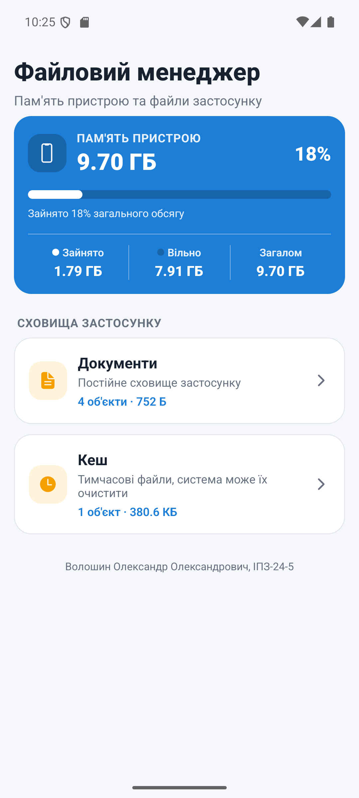
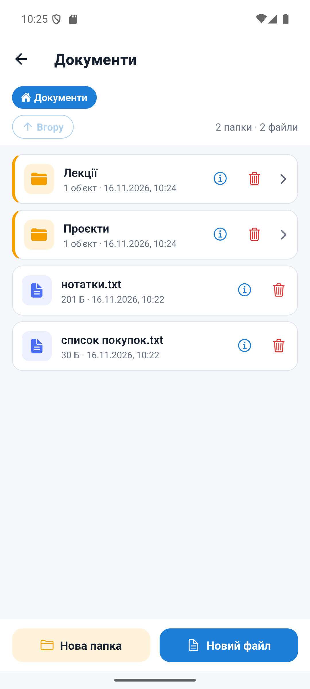
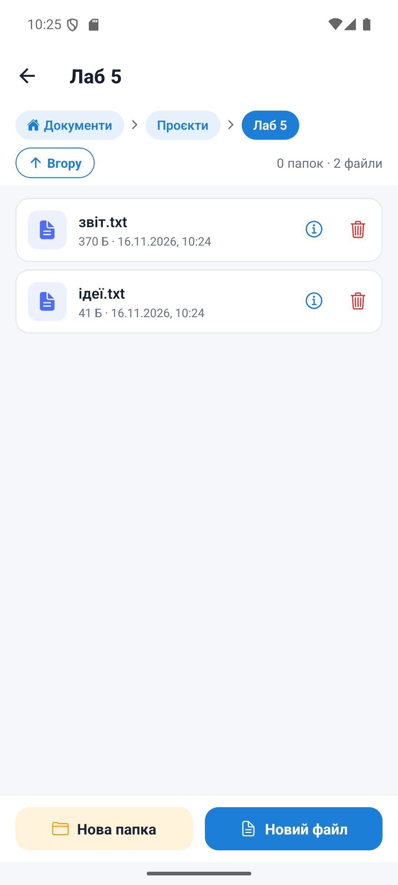
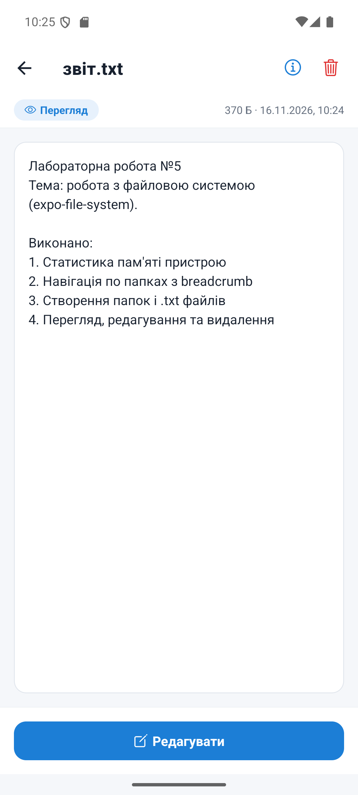
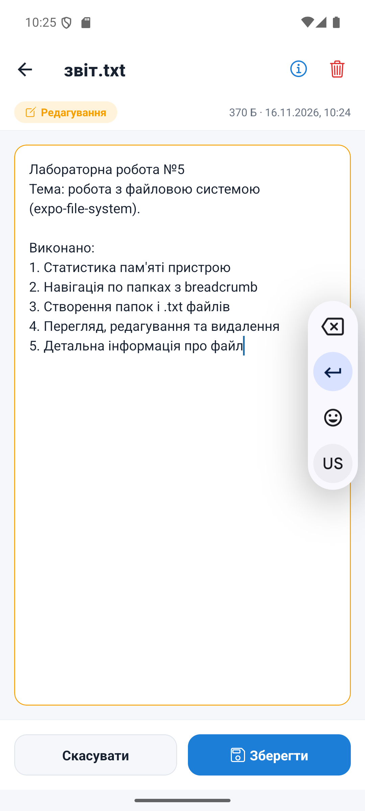
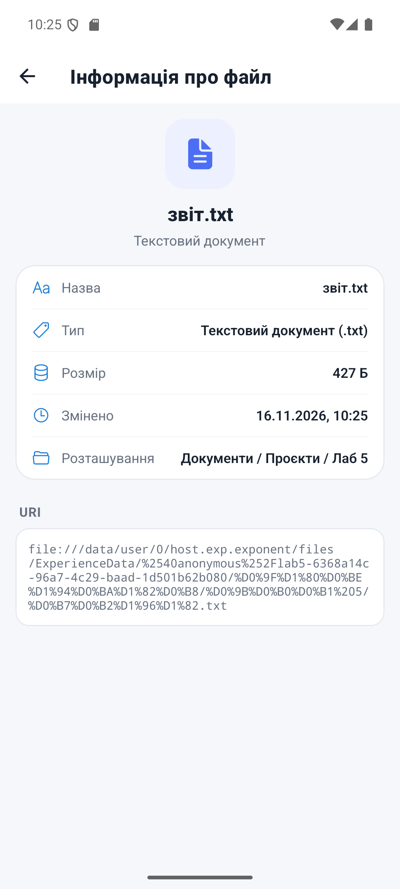

# Лабораторна робота №5

**Тема:** Робота з файловою системою в React Native з використанням бібліотеки expo-file-system.

**Студент:** Волошин Олександр Олександрович, ІПЗ-24-5

## Опис проєкту

Мобільний додаток «Файловий менеджер» на React Native (Expo SDK 58, Expo Router). Застосунок показує статистику пам'яті пристрою та дозволяє працювати з локальними файлами застосунку: переходити між папками, створювати папки й текстові файли, переглядати й редагувати `.txt`, видаляти об'єкти та дивитися детальну інформацію про них. Уся робота з файлами виконана через новий об'єктний API бібліотеки `expo-file-system` (класи `Paths`, `Directory`, `File`), а не через `expo-file-system/legacy`. Проєкт створено командою `npx create-expo-app@latest`, демонстраційний код прибрано через `npm run reset-project`, бібліотеку встановлено через `npx expo install expo-file-system`.

| Екран | Файл | Що реалізовано |
|---|---|---|
| **Головний** | `app/index.jsx` | Загальний, вільний і зайнятий обсяг пам'яті пристрою, прогрес-бар заповненості, картки сховищ «Документи» та «Кеш» з кількістю об'єктів і розміром |
| **Провідник** | `app/browser.jsx` | Заголовок і breadcrumb з поточним шляхом, кнопка «Вгору», вміст папки у `FlatList` (папки першими), перехід у вкладені папки, кнопки створення, інформації та видалення |
| **Створення** | `app/create.jsx` | Модальне вікно з `TextInput`: нова папка або новий `.txt` файл з ім'ям і початковим вмістом, перевірка назви |
| **Файл** | `app/file.jsx` | Перегляд вмісту `.txt`, режим редагування, збереження змін, попередження про незбережені зміни (`usePreventRemove`) |
| **Інформація** | `app/info.jsx` | Назва, тип за розширенням, розмір, дата останньої модифікації, розташування й URI; для папки — кількість об'єктів |

### Робота з файловою системою

Уся логіка зібрана у `utils/fileSystem.js`. Шлях усередині сховища зберігається як рядок відносно кореня (`Notes/2026`), а потрібний об'єкт створюється конструктором `new Directory(Paths.document, ...сегменти)` або `new File(...)`.

| Операція | API `expo-file-system` |
|---|---|
| Статистика пам'яті | `Paths.totalDiskSpace`, `Paths.availableDiskSpace`, зайнято = загальний − вільний |
| Вміст папки | `directory.list()` → масив `Directory` і `File`, тип визначається через `instanceof` |
| Створення папки | `parent.createDirectory(name)` |
| Створення файлу | `file.create()` + `await file.write(content)` |
| Читання файлу | `await file.text()` |
| Збереження змін | `await file.write(content)` |
| Видалення | `file.delete()` / `directory.delete()` (папка видаляється разом із вмістом) |
| Метадані | `file.info()` / `directory.info()` → `exists`, `size`, `modificationTime`; `file.name`, `file.extension`, `file.uri` |

Перед створенням перевіряється, що назва не порожня, не містить символів `\ / : * ? " < > |` і що об'єкт з такою назвою ще не існує. До імені файлу автоматично додається `.txt`.

### Навігація

Навігацію побудовано на `Stack` з Expo Router. Кожна вкладена папка відкривається окремим екраном `/browser?root=document&path=Notes/2026`, тому системна кнопка «Назад» працює як перехід на рівень вище. Кнопка «Вгору» та breadcrumb закривають потрібну кількість екранів через `router.dismiss(n)`. Створення файлу чи папки відкривається як модальне вікно (`presentation: "modal"`), після закриття якого провідник оновлює список у `useFocusEffect`.

Інтерфейсна логіка:

- папки виділено жовтою іконкою, смужкою зліва та стрілкою переходу, файли — синьою іконкою з розміром;
- над списком показано breadcrumb (активна папка підсвічена) і лічильник «N папок · M файлів»;
- видалення підтверджується нативним діалогом `Alert.alert()`; для непорожньої папки вказано кількість об'єктів усередині;
- безпечні зони екрана враховано через `SafeAreaProvider` і `SafeAreaView` з `react-native-safe-area-context`.

### Структура

```
lab5/
├── app/
│   ├── _layout.jsx          # SafeAreaProvider + Stack
│   ├── index.jsx            # статистика пам'яті та сховища
│   ├── browser.jsx          # провідник по папках (FlatList)
│   ├── create.jsx           # модальне вікно створення папки / файлу
│   ├── file.jsx             # перегляд і редагування .txt
│   └── info.jsx             # детальна інформація
├── components/              # StorageCard, RootCard, Breadcrumbs, EntryRow, ScreenHeader
├── constants/theme.js       # кольори, відступи, дані студента
└── utils/
    ├── fileSystem.js        # операції з expo-file-system
    ├── actions.js           # підтвердження видалення через Alert.alert
    └── format.js            # формат розміру, дати, типу файлу
```

## Інструкція з запуску

### Що потрібно встановити

- [Node.js](https://nodejs.org/) версії 20 або новіше;
- [Git](https://git-scm.com/);
- [Android Studio](https://developer.android.com/studio) зі створеним віртуальним пристроєм: **Device Manager → Create Virtual Device**.

### Запуск

1. Клонуйте репозиторій і перейдіть у папку лабораторної:

   ```bash
   git clone https://github.com/Simpson4ik/MobileLabsRN2026.git
   cd MobileLabsRN2026/lab5
   ```

2. Встановіть залежності:

   ```bash
   npm install
   ```

3. Запустіть емулятор в Android Studio (**Device Manager → ▶**).

4. Запустіть застосунок:

   ```bash
   npx expo start --android
   ```

   Якщо застосунок не оновлюється, запустіть з очищенням кешу: `npx expo start --clear`. Якщо телефон і комп'ютер у різних мережах — `npx expo start --tunnel`.

## Скріншоти

| Головний екран | Провідник | Вкладена папка |
|:---:|:---:|:---:|
|  |  |  |

| Нова папка | Новий файл | Підтвердження видалення |
|:---:|:---:|:---:|
|  |  |  |

| Перегляд файлу | Редагування файлу | Інформація про файл |
|:---:|:---:|:---:|
|  |  |  |

## Висновки

Під час роботи я опанував новий об'єктний API бібліотеки `expo-file-system`: доступ до сховищ застосунку через `Paths.document` і `Paths.cache`, роботу з папками та файлами через класи `Directory` і `File`, читання й запис тексту, видалення та отримання метаданих. Статистику пам'яті пристрою отримано з `Paths.totalDiskSpace` і `Paths.availableDiskSpace`. Навігацію по файловій системі побудовано на `Stack` з Expo Router: кожна папка — окремий екран, тому кнопка «Назад» природно переходить на рівень вище, а breadcrumb і кнопка «Вгору» закривають потрібну кількість екранів. Вміст папки відображається у `FlatList`, введення назв і тексту — через `TextInput` у модальному вікні, а видалення підтверджується нативним `Alert.alert()`. Перевірка на емуляторі показала, що назви з кирилицею та пробілами коректно кодуються в URI (`%D0%B7...`) самою бібліотекою.

### Відповіді на контрольні запитання

**1. Які основні директорії надає бібліотека expo-file-system (зокрема documentDirectory та cacheDirectory) і в чому полягає різниця між ними?**

У новому API директорії доступні як статичні властивості класу `Paths` (у legacy API — константи `documentDirectory` і `cacheDirectory`):

- **`Paths.document`** — постійне сховище застосунку. Файли зберігаються, доки користувач не видалить застосунок або їх не видалить сам застосунок. Тут зберігають дані користувача: документи, нотатки, налаштування. На iOS ця папка потрапляє в резервну копію iCloud;
- **`Paths.cache`** — тимчасове сховище. Система може очистити його, коли на пристрої закінчується місце, тому там зберігають лише те, що можна відновити: завантажені зображення, проміжні файли, кеш мережевих запитів;
- **`Paths.bundle`** — тільки для читання, містить ресурси, вбудовані в збірку застосунку.

Обидві основні директорії належать лише застосунку (sandbox): інші застосунки не мають до них доступу, а дозволи на читання чи запис не потрібні. В Expo Go кожен проєкт отримує власну підпапку `ExperienceData/...`, що видно в URI на екрані інформації.

**2. Які базові методи expo-file-system використовуються для читання, запису, створення директорій та видалення файлів і папок?**

Об'єкт створюється конструктором з шляхом: `new File(Paths.document, "Notes", "a.txt")`, `new Directory(Paths.document, "Notes")`.

| Дія | Новий API | Legacy API |
|---|---|---|
| Читання тексту | `await file.text()` або `file.textSync()` | `readAsStringAsync(uri)` |
| Запис тексту | `await file.write(text)` або `file.writeSync(text)` | `writeAsStringAsync(uri, text)` |
| Створення файлу | `file.create()` або `directory.createFile(name, mime)` | неявно під час запису |
| Створення папки | `directory.create()` або `parent.createDirectory(name)` | `makeDirectoryAsync(uri, { intermediates })` |
| Вміст папки | `directory.list()` → масив `File` і `Directory` | `readDirectoryAsync(uri)` → масив імен |
| Видалення | `file.delete()`, `directory.delete()` | `deleteAsync(uri)` |
| Копіювання / переміщення | `copy(dest)`, `move(dest)`, `rename(name)` | `copyAsync`, `moveAsync` |

`directory.delete()` видаляє папку разом із вмістом, тому в застосунку перед цим показується підтвердження з кількістю вкладених об'єктів. Наявність об'єкта перевіряється властивістю `exists`.

**3. Як отримати метадані про об'єкт файлової системи (розмір, дату останньої модифікації) та інформацію про загальний і вільний обсяг пам'яті пристрою?**

Метадані доступні як властивості `File`: `file.size` (байти), `file.modificationTime` (мілісекунди від 1970 р.), `file.name`, `file.extension`, `file.uri`, `file.type` (MIME). Метод `file.info()` повертає їх одним об'єктом `{ exists, size, modificationTime, uri, md5? }`, а `directory.info()` — те саме для папки разом зі списком `files`. Розмір папки з усім вмістом дає `directory.size`. У legacy API аналогом є `getInfoAsync(uri, { size: true })`.

Обсяг пам'яті пристрою повертають статичні властивості `Paths.totalDiskSpace` і `Paths.availableDiskSpace` (у байтах; у legacy — `getTotalDiskCapacityAsync()` і `getFreeDiskStorageAsync()`). Зайнятий обсяг обчислюється як різниця: `total − available`. У проєкті байти переводяться в КБ/МБ/ГБ функцією `formatBytes`, а дата — функцією `formatDate` з `utils/format.js`.
